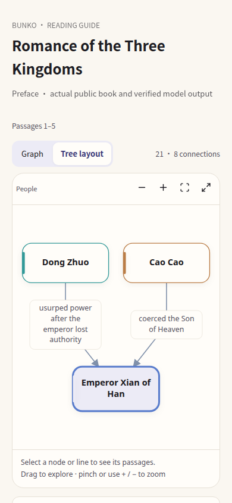
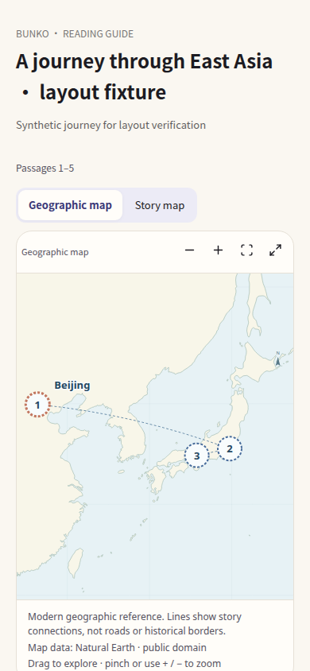
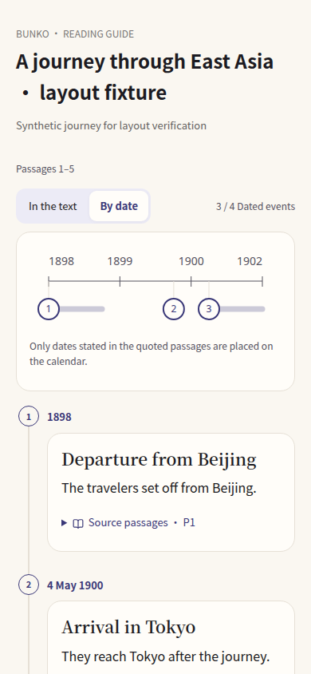

[English](../README.md) · [العربية](README.ar.md) · [Español](README.es.md) · [Français](README.fr.md) · [日本語](README.ja.md) · [한국어](README.ko.md) · [Tiếng Việt](README.vi.md) · [中文 (简体)](README.zh-Hans.md) · [中文（繁體）](README.zh-Hant.md) · [Deutsch](README.de.md) · [Русский](README.ru.md)

[](https://lazying.art)

# Bunko 文庫

*Lee entre idiomas sin perder el hilo del libro.*

[Web / PWA](https://lachlan.lazying.art/Bunko/) · [iPhone / iPad / Apple Watch](https://apps.apple.com/app/id6815137919) · [Mac App Store](https://apps.apple.com/app/id6815137919?platform=mac) · [Google Play](https://play.google.com/store/apps/details?id=art.lazying.bunko)

Bunko reúne clásicos de dominio público y libros originales con autorización de distribución en una biblioteca multilingüe. Lee pasajes alineados, consulta pinyin y furigana sobre el texto y conserva tus descargas sin conexión. Literatura, viajes, aprendizaje y obras técnicas comparten un lector que mantiene figuras y ecuaciones.

## Lee a tu manera

- Elige un idioma o intercala varios, frase por frase. El orden de selección determina el principal; las traducciones conservan etiquetas claras.
- Ajusta por separado el texto y las anotaciones ruby. Usa el tema claro, oscuro o del sistema y mantén pulsada una palabra para consultar el diccionario.
- Descarga libros y paquetes opcionales de diccionarios de inglés, chino y japonés. Ábrelos sin conexión en tu posición guardada.
- Lee en iPhone, iPad, Android, web y Mac. Envía fragmentos multilingües con ruby a un Apple Watch enlazado.
- Los libros admiten cualquier número de idiomas, incluidas escrituras de derecha a izquierda. La interfaz ofrece inglés, chino simplificado, chino tradicional y japonés.

## Un compañero junto al libro

El compañero de lectura reúne el contexto automático del libro, las referencias @ compactas a libros, capítulos y pasajes, y el regreso al texto exacto. Explora relaciones entre personajes en gráficos o árboles, lugares en un mapa geográfico sin conexión y acontecimientos en una línea temporal con fechas. Los pasajes que sustentan cada guía quedan a mano.

**Disponible en iOS y Android 1.0.14 (37). Mac40 sigue en revisión; la versión pública para Mac es 1.0.13 (23). El lector web se actualiza por separado.** Las guías abarcan fragmentos seleccionados o muestreados y pueden ser incompletas. Los lugares y fechas inciertos se indican expresamente. Las imágenes son capturas reales de los componentes; el mapa y la cronología usan un recorrido de demostración identificado como tal. [Detalles del avance](../docs/reading-guides-preview.md).

**Mapas históricos en pruebas internas:** provincias con distintos colores, marcadores con nombres de ciudades y preguntas de seguimiento para ampliar el mapa guardado. La capa Han oriental indica el año de referencia y las fuentes. [Detalles y vista previa](../docs/reading-tools-and-historical-maps.md).

<p>
<a href="../docs/images/reading-guides-20261021/phone-graph-focused.png"></a>
<a href="../docs/images/reading-guides-20261021/phone-map.png"></a>
<a href="../docs/images/reading-guides-20261021/phone-timeline.png"></a>
</p>

## Ejecutar y compilar

Usa Node.js 22. Instala ambos conjuntos de dependencias, ejecuta las comprobaciones e inicia el lector. La aplicación usa React/TypeScript, Capacitor en iOS y Android, y AppKit/WebKit en Mac. Las credenciales de firma quedan fuera de Git.

```sh
npm ci
npm ci --prefix server
npm run check
npm run dev
```

Prepara los recursos web incluidos en los paquetes nativos:

```sh
npm run build:native
npm run build:macos
```

## Contenido del repositorio

| Ruta | Contenido |
| --- | --- |
| [src/](../src/) | Lector, disposición de idiomas, caché local e interfaz del compañero |
| [server/](../server/) | Servicios de cuenta, conversaciones y compañero opcional |
| [ios/ · android/ · macos/](../ios/) | Proyectos de plataforma y complemento para Apple Watch |
| [docs/](../docs/) | Guías de lectura, publicación de libros y plataformas |


## Libros, conversaciones y privacidad

Los libros y sus registros de derechos están en [bunko-books](https://github.com/lachlanchen/bunko-books), separados del código. Las nuevas ediciones compatibles pueden llegar sin actualizar la aplicación. GitHub es la fuente principal de descarga, con alternativas de CDN y caché propia. Las conversaciones públicas sobre pasajes usan el acceso de GitHub; las notas privadas, los borradores sin publicar y las conversaciones personales con el compañero no son comentarios públicos. La lectura habitual de descargas no requiere suscripción. El material generado puede contener errores; consulta el texto citado. Las tiendas muestran las versiones públicas actuales y la disponibilidad regional.

[Bunko issues](https://github.com/lachlanchen/Bunko/issues) · [bunko-books issues](https://github.com/lachlanchen/bunko-books/issues)

## Apoya Bunko

Bunko es un proyecto de LazyingArt. El apoyo voluntario ayuda a mantener el lector y sus herramientas abiertas de biblioteca.

<!-- support:start -->
[](https://github.com/sponsors/lachlanchen)
[](https://chat.lazying.art/donate)
[](https://paypal.me/RongzhouChen)
[](https://buy.stripe.com/aFadR8gIaflgfQV6T4fw400)
<!-- support:end -->

## Cita

Si utilizas Bunko en investigación, cita este repositorio. GitHub lee [CITATION.cff](../CITATION.cff) para ofrecer su panel de citas.

```bibtex
@software{chen_bunko_2026,
  author = {Chen, Lachlan},
  title = {Bunko: Classics with Ruby},
  year = {2026},
  url = {https://github.com/lachlanchen/Bunko}
}
```
